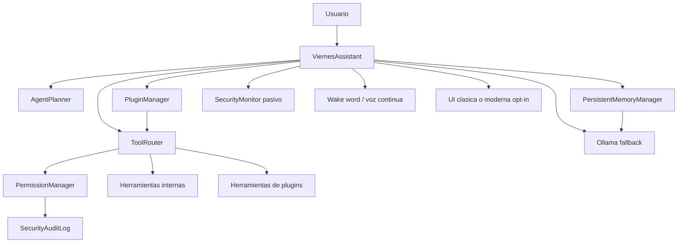

# Arquitectura de Agentes de Viernes

Viernes mantiene `viernes.py` como entrada publica y evoluciona con una capa de
agentes dentro de los paquetes existentes. Los JSON historicos siguen en la raiz
por compatibilidad; los artefactos nuevos se escriben en `runtime/`.

## Componentes

- `AgentPlanner`: crea planes tipados, persistidos, priorizados y ejecutables en
  modo secuencial. Los pasos mutables requieren aprobacion y no corren en
  dry-run.
- `PersistentMemoryManager`: administra memoria corta, memoria larga,
  conversaciones, preferencias y proyectos activos en `runtime/memory/`.
- `ToolRouter`: registra herramientas internas y de plugins con accion,
  esquema, origen, indicador de mutacion y confirmacion requerida.
- `PermissionManager`: aplica niveles 0-3, rutas autorizadas, allowlist de
  scripts, deny-by-default para acciones desconocidas y auditoria.
- `PluginManager`: descubre, valida y carga plugins locales con `plugin.json` y
  `main.py`; los plugins exponen herramientas a traves del router.
- `self_improvement`: analiza, propone, prueba, revisa y persiste propuestas en
  `runtime/self_improvement/proposals/` sin modificar codigo directamente.
- `SecurityMonitor`: genera recomendaciones pasivas sobre archivos criticos,
  procesos y conectividad, con baseline en `runtime/security_monitor/`.
- `voice` y `ui`: voz continua opt-in, perfiles, interrupciones y shell moderno
  opt-in con fallback Tkinter.

## Flujo



## Interfaces publicas

- `AgentPlanner.create_plan(objective, context=None) -> AgentPlan`
- `AgentPlanner.execute_plan(plan_id, approvals=None, dry_run=True) -> AgentExecutionReport`
- `PersistentMemoryManager.remember(scope, key, value, metadata=None)`
- `PersistentMemoryManager.build_ollama_context(prompt, limit)`
- `ToolRouter.register_tool(name, action, description, handler, ...)`
- `ToolRouter.route(text, user_level=None) -> ToolRequest`
- `PermissionManager.check(action, target="", level=None, confirmed=False)`
- `PluginManager.discover()`, `PluginManager.load_enabled()`,
  `PluginManager.registered_tools()`

## Seguridad

- Nivel 0: solo conversacion.
- Nivel 1: abrir programas, leer/listar recursos autorizados, memoria,
  reportes runtime, plugins seguros y monitor pasivo.
- Nivel 2: escribir archivos, modificar datos y ejecutar scripts permitidos.
- Nivel 3: control administrativo completo.

Las acciones desconocidas se deniegan por defecto. Las mutaciones registradas
requieren confirmacion explicita aunque el nivel sea suficiente. Las lecturas se
limitan a raices autorizadas; los scripts tienen allowlist separada.

## Plugins

Estructura minima:

```text
mi_plugin/
  plugin.json
  main.py
```

`plugin.json` debe declarar `name` y `version`; puede declarar `enabled`,
`trust_level`, `required_level`, `description` y `capabilities`. `main.py` debe
exponer `register(api)` y usar `api.register_tool(...)`.

## Organizacion de documentos

El plan "organiza mis documentos" se ejecuta de forma segura:

1. Previsualiza archivos y categorias.
2. Clasifica por extension.
3. Genera propuesta/informe en `runtime/reports/`.
4. Bloquea crear directorios y mover archivos durante dry-run.
5. Solo aplica cambios con aprobacion explicita y permisos de nivel 2.

## Compatibilidad

Se mantienen `viernes.py`, `viernes_config.json`, `viernes_state.json`,
`viernes_agenda.json` y `viernes_budget.json`. La UI clasica sigue siendo la
predeterminada; la moderna se activa con `ui.mode=modern` o el comando
`activar interfaz moderna`.
