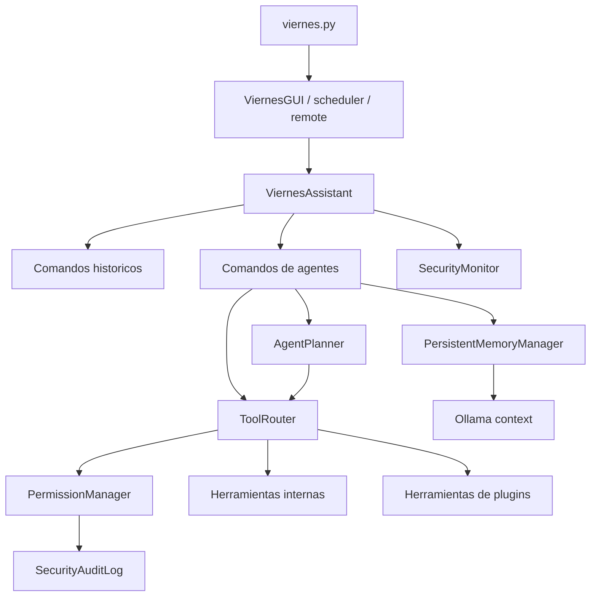

# Arquitectura de Viernes

Este proyecto conserva `viernes.py` como punto de entrada publico y mueve la
logica real a paquetes internos. La regla general es: la raiz solo debe tener
lanzadores, configuracion historica y datos compatibles con versiones previas.

## Entrada

- `viernes.py`: CLI principal. Modos: `gui`, `scheduler`, `morning`, `remote`.
- `viernes_start.cmd`: abre la GUI desde la ubicacion real del script.
- `viernes_morning.cmd`: ejecuta solo el informe matutino.
- `scripts/windows/install_viernes_autostart.ps1`: crea acceso de inicio y
  tarea programada.
- `scripts/windows/remove_viernes_autostart.ps1`: quita el modo residente.
- `scripts/windows/install_dependencies.bat`: instalador manual de
  dependencias.
- `scripts/tools/build_exe.py`: herramienta de empaquetado.

## Paquetes

- `viernes_app/core/`: cerebro del asistente, agenda, rutinas y scheduler.
- `viernes_app/services/`: servicios de dominio: noticias, presupuesto,
  agenda, clases, aprendizaje y almacenamiento heredado.
- `viernes_app/integrations/`: integraciones externas: Ollama, Wake/Windows,
  Telegram.
- `viernes_app/ui/`: GUI de Tkinter, avatar y shell moderno opt-in.
- `viernes_app/voice/`: voz, TTS, perfiles, wake word e interrupciones.
- `ai/`, `utils/`, `storage/`, `security/`: modulos auxiliares mantenidos por
  compatibilidad.
- `jarvis_os_v5/`: laboratorio integrado; solo se importa para utilidades que
  Viernes ya usa.
- `legacy/jarvis/`: asistente monolitico antiguo, conservado como referencia
  pero fuera del flujo principal de Viernes.

## Datos y runtime

- `viernes_config.json`: configuracion principal.
- `viernes_state.json`, `viernes_agenda.json`, `viernes_budget.json`: datos
  historicos en raiz por compatibilidad.
- `runtime/`: cache y archivos generados nuevos. No se versiona.
- `jarvis_os_v5/config.example.json`: ejemplo de configuracion para builds.

## Reglas para crecer sin volver al desorden

- Los nuevos servicios van en `viernes_app/services/`.
- La logica de decisiones del asistente va en `viernes_app/core/`.
- Las integraciones con programas o APIs externas van en
  `viernes_app/integrations/`.
- La raiz no debe recibir nuevos `.py` salvo wrappers de compatibilidad.
- Los scripts manuales van en `scripts/windows/` o `scripts/tools/`.
- Codigo viejo que no participa en `viernes.py` va a `legacy/`, no a la raiz.
- Si un archivo es generado o cache, debe ir a `runtime/`.

## Sistema de agentes

Viernes incorpora una capa nueva de agentes sin reemplazar los comandos
historicos:

- `viernes_app/core/planner.py`: planes estructurados, persistidos, con dry-run,
  dependencias y aprobacion para pasos mutables.
- `viernes_app/core/memory_manager.py`: memoria persistente en `runtime/memory/`
  con contexto acotado y redaccion para Ollama.
- `viernes_app/core/tool_router.py`: registro, seleccion y ejecucion de
  herramientas internas y plugins con permisos.
- `security/`: niveles de usuario, permisos deny-by-default, autenticacion y
  auditoria con correlacion.
- `viernes_app/plugins/`: plugins locales con `plugin.json` validado y `main.py`.
- `viernes_app/core/self_improvement/`: auto-mejora controlada por propuesta,
  pruebas, revision y aprobacion.
- `viernes_app/services/security_monitor/`: monitoreo pasivo cacheado de
  seguridad, con baseline persistente.

## Flujo de ejecucion

## Puntos de expansion

- Registrar herramientas nuevas con `ToolRouter.register_tool(...)` y declarar
  accion, mutacion y confirmacion.
- Agregar plugins bajo `viernes_app/plugins/<nombre>/` con `plugin.json` y
  `main.py`.
- Agregar paneles a `viernes_app/ui/modern.py`; la UI moderna se activa con
  `ui.mode=modern`.
- Agregar capacidades de voz en `viernes_app/voice/` sin iniciar escucha
  continua salvo configuracion/comando explicito.

Ver `docs/AGENT_ARCHITECTURE.md` para el diagrama actualizado.
